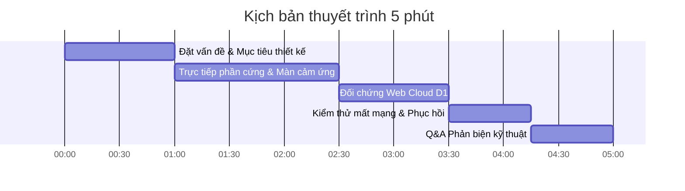

# 🎤 KỊCH BẢN THUYẾT TRÌNH ĐỀ TÀI IOT (5 PHÚT)
## HỘI ĐỒNG CHẤM ĐIỂM SAMSUNG INNOVATION CAMPUS 2026

- **Đề tài**: **DUSTGUARD VN — TRẠM QUAN TRẮC BỤI MỊN THỜI GIAN THỰC (APM2000 & ESP32)**  
- **Sinh viên**: **Phạm Phú Nguyễn Hưng** (MSSV: **26730023** — UIT CNTT)  
- **Giảng viên hướng dẫn**: **TS. Nguyễn Văn Thái** (Khoa Điện-Điện tử, HCM-UTE)  
- **Số thứ tự nhóm**: **Nhóm 11**  
- **Chi phí phần cứng tối ưu**: **~490.000 VNĐ / Trạm** (BOM tiết kiệm 80% so với trạm nhập khẩu)

---

## ⏱️ PHÂN BỔ THỜI GIAN THUYẾT TRÌNH

---

### PHẦN 1: MỞ ĐẦU & ĐẶT VẤN ĐỀ (0:00 - 1:00)
> **Lời thoại mẫu:**  
> *"Kính thưa Thầy Nguyễn Văn Thái và quý Thầy trong Hội đồng Samsung Innovation Campus 2026!  
> Em là Phạm Phú Nguyễn Hưng, sinh viên CNTT trường ĐH Công nghệ Thông tin ĐHQG-HCM, đại diện Nhóm 11.  
> Hiện nay, ô nhiễm bụi mịn PM2.5 tại các đô thị lớn ở Việt Nam đang là vấn đề nhức nhối ảnh hưởng sức khỏe cộng đồng. Tuy nhiên, các trạm quan trắc tiêu chuẩn hiện nay có giá thành hàng chục triệu đồng, khiến mật độ lắp đặt rất thưa thớt và người dân khó tiếp cận số liệu tại chỗ.  
> Vì vậy, nhóm em phát triển **DustGuard VN** — Trạm IoT đo bụi mịn thời gian thực giá rẻ chỉ khoảng 490.000 VNĐ, trang bị màn hình cảm ứng 3.5 inch tương tác tại hiện trường và đồng bộ dữ liệu bảo mật HMAC-SHA256 lên nền tảng Cloudflare Serverless D1."*

---

### PHẦN 2: THAO TÁC TRỰC TIẾP TRÊN PHẦN CỨNG & MÀN CẢM ỨNG (1:00 - 2:30)
*(Bật mạch thật hoặc mở file `CHAY_DEMO_TOUCHSCREEN_SIMULATOR.bat` để trình chiếu)*

1. **Màn hình HOME (Số liệu trực quan tại chỗ)**:
   - *"Trên màn hình 3.5 inch, người dân có thể thấy ngay chỉ số **PM2.5** hiển thị to rõ (ví dụ 28.5 µg/m³), phân loại màu theo **QCVN 05:2023** (Tốt, Trung bình, Kém, Nguy hại)."*
   - Cảm biến **ASAIR APM2000** sử dụng nguyên lý tán xạ vi hạt laser, đọc liên tục mỗi 2 giây qua giao tiếp UART 9600 baud.
2. **Màn hình CHART (Đồ thị lịch sử không cần máy tính)**:
   - Chạm vào nút **[CHART]**: *"Đây là điểm độc đáo của trạm — người kiểm tra ngoài hiện trường không cần mở laptop vẫn xem được đồ thị dao động của PM1.0, PM2.5 và PM10 trong 60 điểm đo gần nhất nhờ thuật toán Circular Buffer lưu trực tiếp trong RAM ESP32."*
3. **Màn hình DEVICE & SENSOR (Chẩn đoán & Minh chứng dữ liệu thật)**:
   - Chạm vào nút **[DEVICE]**: Cho hội đồng xem Uptime, cường độ sóng Wi-Fi RSSI, số gói tin đã gửi thành công.
   - Chạm vào nút **[MORE] -> SENSOR DIAGNOSTICS**: *"Hệ thống kiểm tra tính toàn vẹn từng khung tin UART 32-byte. Tỉ lệ frame hợp lệ 100% chứng minh dữ liệu đo đạc hoàn toàn từ phần cứng thật, loại bỏ mọi nguy cơ giả lập số liệu."*

---

### PHẦN 3: ĐỐI CHỨNG VỚI NỀN TẢNG CLOUD & WEB DASHBOARD (2:30 - 3:30)
1. **Mở trình duyệt truy cập Web Dashboard**:
   - Mở route `/sic`: Trang bìa đề tài chính thức với thông tin chuẩn quy cách Samsung Innovation Campus.
   - Bấm nút **"Vào Hệ Thống Giám Sát"** chuyển sang `/iot`.
2. **Đối chiếu số liệu thời gian thực (Zero Lag & Zero Fake Data)**:
   - *"Kính mời Thầy quan sát: Giá trị PM2.5 hiển thị trên màn hình trạm và trên Web Dashboard của hệ thống hoàn toàn trùng khớp từng giây. Dữ liệu được đẩy lên qua Cloudflare Worker REST API và lưu trữ bền vững vào SQLite D1 Database. Bấm F5 tải lại trang, toàn bộ lịch sử đo đạc vẫn được bảo toàn nguyên vẹn."*

---

### PHẦN 4: THỬ NGHIỆM ĐỘ BỀN KHI MẤT MẠNG (OFFLINE RESILIENCE) (3:30 - 4:15)
1. **Tắt kết nối Wi-Fi / Hotspot**:
   - *"Trong thực tế, trạm đo ngoài trời có thể bị rớt sóng. Khi em ngắt Wi-Fi, màn hình trạm chuyển icon Cloud sang màu đỏ, nhưng cảm biến vẫn tiếp tục đo đều đặn mỗi 2 giây."*
2. **Cơ chế Offline Buffer Ring**:
   - *"Các gói tin chưa gửi được đưa vào hàng đợi đệm trong bộ nhớ ESP32. Ngay khi em bật lại Wi-Fi, ESP32 tự động tái kết nối trong 3 giây và bắn bù các gói tin còn thiếu lên Cloud mà không làm rơi rớt dữ liệu của cộng đồng."*

---

### PHẦN 5: TỔNG KẾT & CÂU HỎI PHẢN BIỆN (4:15 - 5:00)

| Câu hỏi của Hội Đồng / Giảng Viên | Câu trả lời chuẩn xác kỹ thuật |
|---|---|
| **1. Cảm biến APM2000 có chính xác hơn PMS7003 hay MQ135 không?** | APM2000 là cảm biến tán xạ laser quang học chuyên dụng phân giải được dải hạt 0.3µm - 10µm với quạt hút cưỡng bức, loại bỏ sai số nhiệt độ của MQ135 (vốn chỉ là cảm biến điện trở nung nóng) và có độ bền quạt cao hơn PMS7003. |
| **2. Làm sao đảm bảo không bị hack hoặc gửi số liệu giả lên trạm?** | Mỗi trạm có một mã `DEVICE_SECRET` lưu trong vi điều khiển. Mọi gói tin POST lên server đều được ký số bằng thuật toán **HMAC-SHA256**. Server kiểm tra chữ ký trước khi chấp nhận ghi vào Database. |
| **3. Nếu nhiều trạm gửi cùng lúc thì Cloudflare D1 có bị nghẽn không?** | Hệ thống áp dụng kiến trúc **RAM Ingestion Layer** (`server/iot-live-state.ts`): Cập nhật trạng thái hiển thị tức thì trên bộ nhớ đệm edge worker trước, sau đó batch-insert vào D1 theo chu kỳ, tối ưu hóa I/O vượt trội. |
| **4. Giá thành 490.000 VNĐ đã bao gồm những gì?** | Đã bao gồm: ESP32 NodeMCU (95k), Cảm biến APM2000 (230k), Màn hình 3.5" TFT Touch SPI (125k), Nguồn & vỏ bảo vệ (40k). So với trạm thương mại 5-10 triệu VNĐ, đây là mức giá lý tưởng để phổ cập cho các trường học và điểm dân cư. |
