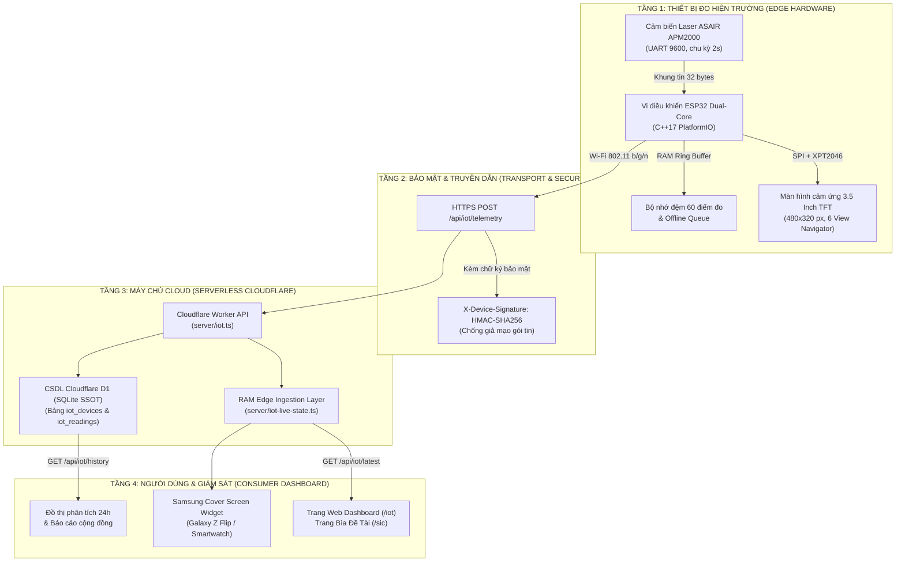

# 🏗️ KIẾN TRÚC HỆ THỐNG & ĐẶC TẢ API IOT (SYSTEM ARCHITECTURE & API CONTRACT)

## 1. Sơ Đồ Kiến Trúc Luồng Dữ Liệu 4 Tầng



---

## 2. Đặc Tả Gói Tin Ingestion (Trạm Gửi Lên Server)

- **Phương thức**: `POST`
- **Đường dẫn**: `/api/iot/telemetry`
- **Headers**:
  - `Content-Type: application/json`
  - `X-Device-Signature: <hmac_sha256_hex>`
  - `X-Device-Timestamp: <epoch_seconds>`

### Định Dạng Payload JSON
```json
{
  "deviceId": "DG-IOT-001",
  "timestamp": "2026-09-20T14:30:00.000Z",
  "pm25": 28.5,
  "pm10": 42.1,
  "pm1": 18.2,
  "temp": 29.4,
  "humidity": 68.0,
  "wifiRssi": -58,
  "firmwareVersion": "2.1.0-sic"
}
```

---

## 3. Đặc Tả API Truy Vấn Số Liệu (Web Dashboard Gọi)

### 3.1 Lấy mẫu đo thời gian thực mới nhất:
- **Phương thức**: `GET`
- **Đường dẫn**: `/api/iot/latest?deviceId=DG-IOT-001`
- **Phản hồi mẫu**:
```json
{
  "success": true,
  "data": {
    "deviceId": "DG-IOT-001",
    "deviceName": "Trạm Quan Trắc Công Viên Gia Định",
    "pm25": 28.5,
    "pm10": 42.1,
    "pm1": 18.2,
    "aqiLevel": "MODERATE",
    "aqiLabel": "Trung Bình",
    "qcvnStatus": "Chấp Nhận Được",
    "status": "ONLINE",
    "updatedAt": "2026-09-20T14:30:00.000Z"
  }
}
```

### 3.2 Lấy lịch sử đo đạc để vẽ đồ thị:
- **Phương thức**: `GET`
- **Đường dẫn**: `/api/iot/history?deviceId=DG-IOT-001&hours=24`

---

## 4. Cấu Trúc Bảng Dữ Liệu Cloudflare D1 (SQLite SSOT)

```sql
-- 1. Bảng quản lý trạm đo vật lý
CREATE TABLE IF NOT EXISTS iot_devices (
  id TEXT PRIMARY KEY,
  device_code TEXT NOT NULL UNIQUE,
  device_name TEXT NOT NULL,
  location_name TEXT NOT NULL,
  latitude REAL NOT NULL,
  longitude REAL NOT NULL,
  sensor_model TEXT DEFAULT 'ASAIR APM2000',
  firmware_version TEXT DEFAULT '2.1.0-sic',
  status TEXT DEFAULT 'OFFLINE', -- ONLINE / OFFLINE
  wifi_ssid TEXT,
  wifi_rssi INTEGER,
  last_reading_at TEXT,
  created_at TEXT DEFAULT CURRENT_TIMESTAMP,
  updated_at TEXT DEFAULT CURRENT_TIMESTAMP
);

-- 2. Bảng lưu trữ chuỗi thời gian các mẫu đo
CREATE TABLE IF NOT EXISTS iot_readings (
  id TEXT PRIMARY KEY,
  device_id TEXT NOT NULL,
  timestamp TEXT NOT NULL,
  pm25 REAL NOT NULL,
  pm10 REAL NOT NULL,
  pm1 REAL,
  temperature REAL,
  humidity REAL,
  wifi_rssi INTEGER,
  created_at TEXT DEFAULT CURRENT_TIMESTAMP,
  FOREIGN KEY (device_id) REFERENCES iot_devices(id) ON DELETE CASCADE
);

-- Chỉ mục composite tối ưu truy vấn thời gian thực
CREATE INDEX IF NOT EXISTS idx_iot_readings_device_time 
ON iot_readings(device_id, timestamp DESC);
```
